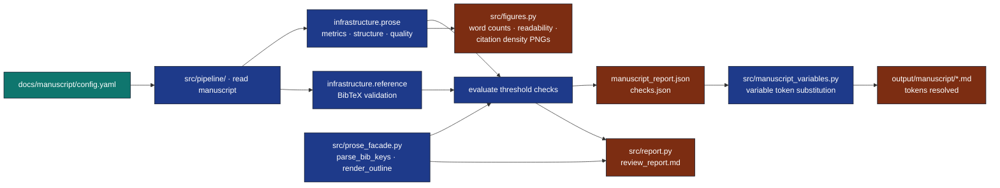

# template_prose_project

A configurable, reproducible **prose-review** pipeline built on
`infrastructure/prose/` (readability + structure + quality) and
`infrastructure/reference/` (BibTeX validation). Exemplar roster:
[`projects/AGENTS.md`](https://github.com/docxology/template/blob/main/projects/AGENTS.md#permanent-canonical-exemplars).

Start with the [documentation index](docs/README.md) or the [pinned setup and render commands](docs/quickstart.md).

## When to use this template

Use this template for **manuscript-focused editorial pipelines**: readability
gates (Flesch-Kincaid bands), structural checking, citation/BibTeX
validation, and prose-quality review workflows where the document itself is
the artifact under test. If you are implementing algorithms with numerical
experiments, start from [`template_code_project`](https://github.com/docxology/template/blob/main/projects/templates/template_code_project)
instead; for book-length structure see
[`template_textbook`](https://github.com/docxology/template/blob/main/projects/templates/template_textbook). Full roster:
[`projects/AGENTS.md`](https://github.com/docxology/template/blob/main/projects/AGENTS.md#permanent-canonical-exemplars).

## Publication and rendering

The publishing metadata and per-platform status below are **compiled from
`docs/manuscript/config.yaml`** by `infrastructure.publishing.status_report` — do not
hand-edit between the markers. From the shared template checkout, regenerate with

```sh
uv run python -m infrastructure.publishing.status_report --project "$project" \
  --config "$project/docs/manuscript/config.yaml" --write
```

Set `project` as shown in the [quickstart](docs/quickstart.md). The pinned status
generator still prints the former path in its legend. Use the explicit
`--config` path above when running it for this checkout.

<!-- PUBLISHING-STATUS:START (generated by infrastructure.publishing.status_report) -->
**Editorial Quality at Scale: A Reproducible Prose-Review Pipeline** · v0.4.2 · MIT · Daniel Ari Friedman

Concept DOI: [10.5281/zenodo.20417104](https://doi.org/10.5281/zenodo.20417104) | Version DOI: [10.5281/zenodo.20932047](https://zenodo.org/records/20932047) | Repository: [docxology/template_prose_project](https://github.com/docxology/template_prose_project)

Publishing surface — 20 platforms, 9 published:

| Platform | Tier | Status | Reference | Credentials |
| --- | --- | --- | --- | --- |
| zenodo | first-class | ✅ published | [10.5281/zenodo.20417104](https://doi.org/10.5281/zenodo.20417104) | `ZENODO_API_TOKEN` |
| github | first-class | ✅ published | [docxology/template_prose_project](https://github.com/docxology/template_prose_project) | `GITHUB_TOKEN` |
| arxiv | first-class | ⚪ available | — | — |
| pypi | first-class | ✅ published | [https://test.pypi.org/project/template-prose-project/0.4.2/](https://test.pypi.org/project/template-prose-project/0.4.2/) | `PYPI_TOKEN`, `TESTPYPI_TOKEN` |
| ipfs_pinata | first-class | ✅ published | [https://gateway.pinata.cloud/ipfs/QmXXUgas1amP7Pd9rRoTdJQiNUzBqKQ4r3Jf85aaGEnjz4](https://gateway.pinata.cloud/ipfs/QmXXUgas1amP7Pd9rRoTdJQiNUzBqKQ4r3Jf85aaGEnjz4) | `PINATA_JWT` |
| ipfs_web3storage | first-class | ⚪ available | — | `WEB3_STORAGE_TOKEN` |
| software_heritage | first-class | ✅ published | [https://archive.softwareheritage.org/browse/origin/?origin_url=https://github.com/docxology/template_prose_project](https://archive.softwareheritage.org/browse/origin/?origin_url=https://github.com/docxology/template_prose_project) | — |
| github_pages | first-class | ✅ published | [https://docxology.github.io/template_prose_project/](https://docxology.github.io/template_prose_project/) | `GITHUB_TOKEN` |
| cloudflare_pages | first-class | ⚪ available | — | `CLOUDFLARE_API_TOKEN` |
| netlify | first-class | ✅ published | [https://6a44425bbd23b314b04b0154--tranquil-kleicha-0c9203.netlify.app](https://6a44425bbd23b314b04b0154--tranquil-kleicha-0c9203.netlify.app) | `NETLIFY_AUTH_TOKEN` |
| huggingface_hub | first-class | ✅ published | [https://huggingface.co/datasets/ActiveInference/template_prose_project](https://huggingface.co/datasets/ActiveInference/template_prose_project) | `HUGGINGFACE_TOKEN`, `HF_TOKEN` |
| osf | first-class | ✅ published | [https://osf.io/sh2r3/](https://osf.io/sh2r3/) | `OSF_TOKEN` |
| amazon_kdp | documented | 🟡 planned | — | `AMAZON_KDP_EMAIL`, `AMAZON_KDP_PASSWORD` |
| google_play_books | documented | 🟡 planned | — | `GOOGLE_PLAY_BOOKS_SERVICE_ACCOUNT_JSON` |
| gumroad | documented | 🟡 planned | — | `GUMROAD_ACCESS_TOKEN` |
| leanpub | documented | 🟡 planned | — | `LEANPUB_API_KEY` |
| lulu | documented | 🟡 planned | — | `LULU_CLIENT_KEY`, `LULU_CLIENT_SECRET` |
| draft2digital | documented | 🟡 planned | — | `DRAFT2DIGITAL_API_TOKEN` |
| stripe | documented | 🟡 planned | — | `STRIPE_SECRET_KEY`, `STRIPE_PUBLISHABLE_KEY` |
| ingramspark | documented | 🟡 planned | — | `INGRAMSPARK_CLIENT_ID`, `INGRAMSPARK_CLIENT_SECRET` |

_Keywords: prose analysis, readability, editorial review, reproducible research, manuscript quality._

_Status legend: ✅ published (durable identifier recorded in `config.yaml`) · 🔵 reserved (identifier reserved but not yet registered by final publication) · ⚪ available (adapter implemented and locally verifiable) · 🟡 planned. This block is generated — edit the manuscript configuration and use the regeneration command above._
<!-- PUBLISHING-STATUS:END -->

The 3 platforms still shown ⚪ available are not automatable to "published" with
current tooling/credentials, not an oversight: **arXiv** has no submission API
in this codebase (`infrastructure.publishing.arxiv` only prepares a local
tarball — a human must upload it via arxiv.org and the resulting `arxiv` URL
would then be added to `publication.published_artifacts`); **Cloudflare
Pages** needs a `CLOUDFLARE_ACCOUNT_ID` the configured API token cannot
auto-discover; **IPFS (Web3.Storage)** has no `WEB3_STORAGE_TOKEN` configured.

The [published artifacts](output/) are a tracked snapshot. To build the sources
in this checkout, [register it with the pinned runner](docs/quickstart.md).

## Why this template — the transferable pattern

The bundled `docs/manuscript/config.yaml` is intentionally permissive (FKGL band
10–18, citation floor 0.0) so the exemplar's *own abstract passes its own
gate*. This is a self-referential pipeline: the document describing the
gate runs *through* the gate. The transferable discipline is that the
explanatory prose and the threshold settings co-evolve — a forker who
tightens `prose.target_grade_level_max` to 14.0 without rewriting the
methodology section will discover that the project's own methodology fails
the methodology check. The pedagogy is "configuration drift is detected by
the artifact itself, not by an external reviewer". A stricter starting
point lives in
[`docs/manuscript/config.yaml.example`](docs/manuscript/config.yaml.example).

## What it does



## Running the project

The [quickstart](docs/quickstart.md) covers installation, native tests, strict
prose review, figure generation, variable hydration, and the pinned PDF, HTML,
and slide build. The [output inventory](docs/output_conventions.md) explains
the generated reports and artifacts.

## Configuration

Every knob lives in `docs/manuscript/config.yaml`:

| Section | Key | Default | Meaning |
|---|---|---|---|
| `prose` | `target_grade_level_min` / `_max` | `10.0 / 18.0` | Acceptable Flesch-Kincaid Grade Level band. |
| `prose` | `long_sentence_threshold` | `35` | Words per sentence above which sentences are flagged. |
| `prose` | `citation_density_min_per_1000` | `0.0` | Minimum citations per 1000 words. |
| `prose` | `require_h1_per_section` | `true` | Every file must have an H1. |
| `prose` | `forbid_skipped_levels` | `true` | Heading levels must be contiguous. |
| `prose` | `preset` | `lenient` (example: `strict`) | Named editorial profile seeding defaults for unset prose knobs. |
| `bibliography` | `references_path` | `docs/manuscript/references.bib` | Path to BibTeX file. |
| `bibliography` | `fail_on_missing` | `true` | Fail if a cited `[@key]` is not in the bib. |
| `bibliography` | `fail_on_unused` | `false` | Fail if a bib entry is never cited. |
| `report` | `output_path` | `output/review_report.md` | Where `write_review_report` writes the markdown review. |
| `report` | `include_per_file_table` | `true` | Include the per-file words/sentences/FRE/FKGL/Fog table. |
| `report` | `include_outline` | `true` | Include the per-file heading outline section. |
| `report` | `include_quality_flags` | `true` | Include the long-sentence/passive/hedge quality-flags section. |
| `llm.review` | `enabled` | `false` | Opt into transcript-backed review validation; network calls remain the fork's responsibility. |

## Agentic research overlays

This exemplar includes two declarative overlays for advisory research controls:

- [`domain_profile.yaml`](domain_profile.yaml) declares the prose-research
  domain, review gates, citation/source policy, artifact expectations, and
  benchmark rubric weights.
- [`experiment_plan.yaml`](experiment_plan.yaml) declares the prose-validation
  conditions, primary metric direction, expected figures and tables, baseline,
  and strict-bibliography ablation.
- [`data/claim_ledger.yaml`](data/claim_ledger.yaml) registers sourced numeric
  claims that are intentionally tied to prose-review code, manuscript examples,
  or generated reports.

These files are validation and benchmark inputs only. They do not generate
experiments, mutate prompts, or run autonomous review agents.

## Architecture

* `src/config.py` — typed YAML loader.
* `src/pipeline/` — receives the pre-analysed `ManuscriptReport`, evaluates the configured checks (bibliography cross-check via `src/prose_facade.parse_bib_keys`), writes the JSON artefacts. **Pure orchestration; zero `infrastructure` imports — the thin `scripts/` call `infrastructure/` on its behalf.**
* `src/figures.py` — matplotlib renderers (no business logic).
* `src/manuscript_variables.py` — abstract substitution variables.
* `src/report.py` — markdown review-report assembly.
* `src/prose_facade.py` — project-owned report Protocols (`ManuscriptReportLike`, `FileReportLike`, …) plus `render_outline` and `parse_bib_keys`; decouples `src/` from `infrastructure.prose`/`infrastructure.reference` internals.
* `scripts/run_prose_pipeline.py` — thin orchestrator.
* `scripts/y_generate_prose_figures.py` — figure stage.
* `scripts/z_generate_manuscript_variables.py` — variable-hydration stage.

## See also

* [`AGENTS.md`](AGENTS.md) — agent-oriented walkthrough.
* [`docs/manuscript/SYNTAX.md`](docs/manuscript/SYNTAX.md) — Pandoc citation / cross-reference conventions for this project.
* [`../../docs/guides/manuscript-semantics.md`](https://github.com/docxology/template/blob/main/docs/guides/manuscript-semantics.md) — repository-wide canonical manuscript semantics.
* [`docs/architecture.md`](docs/architecture.md) — architectural diagram.
* [`docs/quickstart.md`](docs/quickstart.md) — getting started guide.
* [`infrastructure/prose/SKILL.md`](https://github.com/docxology/template/blob/main/infrastructure/prose/SKILL.md) —
  underlying prose-analysis API.

## Template integrity

- Forward backlog: [`TODO.md`](docs/TODO.md).
- Copy-and-customize config: [`docs/manuscript/config.yaml.example`](docs/manuscript/config.yaml.example).
- Project validation: `uv run pytest projects/templates/template_prose_project/tests/ --cov=projects/templates/template_prose_project/src --cov-fail-under=90`.
- Repo drift validation: `uv run python scripts/audit/check_template_drift.py --strict`.

<!-- foam-orphan-nav:start (hand-maintained: links sub-docs so they are reachable; no generator refreshes or validates this block) -->

## Directory & sub-document map

Navigation links to in-tree documents (keeps them discoverable):

- [Data Directory Instructions](data/AGENTS.md)
- [template_prose_project/data](data/README.md)

<!-- foam-orphan-nav:end -->
